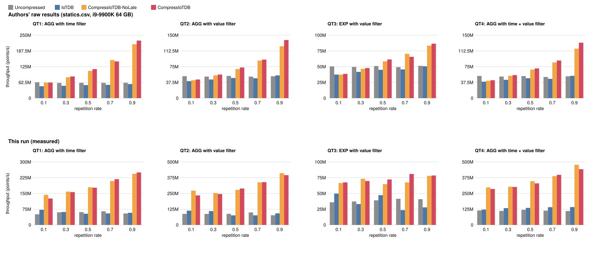

# Reproducing Fig. 9 of "Improving Time Series Data Compression in Apache IoTDB"

CSI5137 Advanced Topics in Data Management, University of Ottawa, Project 2 (reproduction).
Harjot Singh (300493889), Rajat Kashyap (300551122).

Paper: Yuxin Tang et al., *Improving Time Series Data Compression in Apache IoTDB*, PVLDB 18(10):
3406-3420, 2025 ([PDF](https://www.vldb.org/pvldb/vol18/p3406-tang.pdf)). Authors' code:
[yuxin370/CompressIoTDB](https://github.com/yuxin370/CompressIoTDB).

## What is reproduced
Fig. 9 of the paper (Section 5.3.1): query throughput against the repetition rate of the data
(0.1, 0.3, 0.5, 0.7, 0.9) on synthetic data with 1 device, 5 FLOAT sensors and 10^8 points per
sensor, RLE encoding + LZ4. Four systems are compared:

| Series | What runs | Data |
|---|---|---|
| Uncompressed | CompressIoTDB build | PLAIN + UNCOMPRESSED |
| IoTDB | stock Apache IoTDB 1.3.3 | RLE + LZ4 |
| CompressIoTDB-NoLate | CompressIoTDB build, `-Dcompressiotdb.nolate=true` | RLE + LZ4 |
| CompressIoTDB | CompressIoTDB build | RLE + LZ4 |

Query types (IoT-Benchmark, the authors' extended version shipped in their repository):

| Id | IoT-Benchmark op | Meaning | In the paper |
|---|---|---|---|
| QT1 | AGG_RANGE | `variance` of 5 sensors over a time window | Fig. 9 |
| QT2 | AGG_VALUE | `variance` of 5 sensors with `value > 7000` | Fig. 9 |
| QT3 | EXP_VALUE | `s/20` on 5 sensors with `value > 7000` | Fig. 9 |
| QT4 | AGG_RANGE_VALUE | time window + `value > 7000` | in the authors' raw logs, not plotted |

**Paper's claim:** the advantage of CompressIoTDB over IoTDB grows with the repetition rate.

## Result
The claim is reproduced for all four query types. Figure: [`fig9_output/fig9.svg`](fig9_output/fig9.svg)
(top row: authors' numbers from their `statics.csv`; bottom row: this run).



CompressIoTDB throughput / IoTDB throughput, **this run**:

| Query | 0.1 | 0.3 | 0.5 | 0.7 | 0.9 |
|---|---|---|---|---|---|
| QT1 AGG, time filter | 1.74x | 2.54x | 3.32x | 3.96x | 4.33x |
| QT2 AGG, value filter | 2.07x | 2.23x | 3.80x | 4.45x | 4.30x |
| QT3 EXP, value filter | 1.36x | 2.10x | 1.53x | 3.44x | 2.82x |
| QT4 AGG, time + value filter | 2.34x | 2.26x | 2.44x | 2.82x | 3.12x |

Same ratio, **authors' raw results** (`statics.csv` in their repository):

| Query | 0.1 | 0.3 | 0.5 | 0.7 | 0.9 |
|---|---|---|---|---|---|
| QT1 AGG, time filter | 1.31x | 1.76x | 2.22x | 2.76x | 4.08x |
| QT2 AGG, value filter | 1.09x | 1.27x | 1.52x | 1.94x | 2.56x |
| QT3 EXP, value filter | 1.03x | 1.15x | 1.37x | 1.44x | 1.71x |
| QT4 AGG, time + value filter | 1.09x | 1.26x | 1.49x | 1.94x | 2.48x |

CompressIoTDB throughput / Uncompressed throughput, this run:

| Query | 0.1 | 0.3 | 0.5 | 0.7 | 0.9 |
|---|---|---|---|---|---|
| QT1 AGG, time filter | 2.49x | 2.61x | 2.90x | 3.35x | 4.58x |
| QT2 AGG, value filter | 2.67x | 2.81x | 3.27x | 3.43x | 5.14x |
| QT3 EXP, value filter | 1.88x | 1.87x | 1.85x | 1.95x | 1.92x |
| QT4 AGG, time + value filter | 2.48x | 2.70x | 2.75x | 3.50x | 4.01x |

CompressIoTDB throughput / CompressIoTDB-NoLate throughput, this run:

| Query | 0.1 | 0.3 | 0.5 | 0.7 | 0.9 |
|---|---|---|---|---|---|
| QT1 AGG, time filter | 0.88x | 0.99x | 0.99x | 1.04x | 1.03x |
| QT2 AGG, value filter | 0.86x | 0.97x | 1.04x | 1.01x | 0.96x |
| QT3 EXP, value filter | 1.01x | 0.95x | 1.11x | 1.20x | 1.01x |
| QT4 AGG, time + value filter | 0.96x | 0.99x | 0.95x | 1.03x | 0.93x |

Absolute throughput, this run (million points/s):

| Query | System | 0.1 | 0.3 | 0.5 | 0.7 | 0.9 |
|---|---|---|---|---|---|---|
| QT1 | Uncompressed | 51 | 60 | 61 | 65 | 55 |
| QT1 | IoTDB | 72 | 62 | 53 | 55 | 58 |
| QT1 | CompressIoTDB-NoLate | 143 | 159 | 180 | 209 | 244 |
| QT1 | CompressIoTDB | 126 | 156 | 177 | 218 | 250 |
| QT2 | Uncompressed | 88 | 87 | 88 | 99 | 77 |
| QT2 | IoTDB | 113 | 110 | 76 | 76 | 92 |
| QT2 | CompressIoTDB-NoLate | 272 | 254 | 279 | 338 | 411 |
| QT2 | CompressIoTDB | 235 | 245 | 289 | 339 | 395 |
| QT3 | Uncompressed | 36 | 37 | 39 | 42 | 41 |
| QT3 | IoTDB | 50 | 33 | 47 | 24 | 28 |
| QT3 | CompressIoTDB-NoLate | 67 | 73 | 65 | 67 | 78 |
| QT3 | CompressIoTDB | 68 | 70 | 72 | 81 | 78 |
| QT4 | Uncompressed | 115 | 111 | 120 | 114 | 110 |
| QT4 | IoTDB | 122 | 133 | 135 | 141 | 142 |
| QT4 | CompressIoTDB-NoLate | 298 | 304 | 347 | 387 | 477 |
| QT4 | CompressIoTDB | 285 | 301 | 330 | 398 | 442 |

Raw numbers: [`fig9_output/fig9_measured.csv`](fig9_output/fig9_measured.csv) and
[`fig9_output/fig9_reference_authors.csv`](fig9_output/fig9_reference_authors.csv). Every value comes
from a benchmark log in [`results/`](results).

### Discussion
1. **Trend agrees with the paper.** CompressIoTDB's throughput rises with the repetition rate for
   every query type; IoTDB and Uncompressed stay roughly flat, as in the paper. QT1 and QT4 rise at
   every step. QT2 and QT3 rise overall but not monotonically (QT3 at 0.5 is below 0.3).
2. **Gains are larger than the authors'**, mostly at low repetition rates (e.g. QT2 at 0.1: 2.07x
   here, 1.09x in the paper). The machine here has 8 GB RAM (server heap 4 GB) against the
   authors' 64 GB; a likely cause is that IoTDB decompresses whole chunks into heap memory and so loses more
   under memory pressure (not measured separately here). The generated data also differs from theirs (see deviation 3 below).
3. **Uncompressed is beaten at every rate.** The paper reports CompressIoTDB slightly behind
   Uncompressed at low repetition. Here Uncompressed reads about 2 GB per dataset against 16-90 MB
   compressed, and with 8 GB RAM that data likely does not stay in the page cache, so I/O dominates.
4. **NoLate is within a few percent of CompressIoTDB** (0.86x-1.20x). The paper reports a 4.4 %
   gap, and the authors' own `statics.csv` shows 4-11 %. These queries read nearly every page, so
   delaying LZ4 decompression saves little; this matches the paper's finding that the benefit of
   late decompression follows how much general-purpose compression contributes.
5. **Variability.** Within one cell (40 queries) the average latency is within 2.1 % of the median
   (median over all 80 cells); the P10-P90 spread is 23 % of the median. The noisiest cells are
   Uncompressed and NoLate QT4. QT3 takes 8-21 s per query and is the noisiest query type across rates.

## Deviations from the paper
1. **Hardware.** MacBook, 8 CPU cores, 8 GB RAM, macOS, JDK 17, server heap `MEMORY_SIZE=4G` for
   every system. Paper: Intel i9-9900K, 64 GB RAM. Compare ratios and trends, not absolute values.
2. **Workload size.** `CLIENT_NUMBER=2`, `LOOP=20` per client (40 queries per cell), and one query
   type per benchmark run. The authors' logs show `LOOP=100` with all query types mixed
   (`OPERATION_PROPORTION=0:0:0:1:1:1:1:0:0:0:0:1`). Separate runs keep each latency clean; the
   variability above shows 40 queries are enough for the trends. Use `LOOP=100 ./run_fig9.sh` for a
   closer match (about 5x longer).
3. **Data generator.** The authors' generator and its parameters are not fully published. Appendix B
   (Algorithm 2) fixes the structure: positive random deltas, zero-delta runs with probability equal
   to the repetition rate, prefix sum, mean scaled to 10^4, 10^8 points. Not given: the delta
   distribution and the maximum run length. This run uses delta ~ N(1, 1) truncated to positive and
   run length uniform in [1, 100] (`RUN_MAX=100`); timestamps (start 1000000000003, 1 s step, 7-day
   partitions) were decoded from the authors' shipped 0.5 dataset. Resulting sizes for 5 sensors:
   90 / 81 / 60 / 36 / 16 MB (RLE + LZ4) at rates 0.1 / 0.3 / 0.5 / 0.7 / 0.9, and about 2 GB plain.
   The authors' shipped 0.5 dataset is about 112 MB, so their data compresses less than this one.
4. **Baselines.** The authors' exact IoTDB and NoLate builds are not in their repository. IoTDB =
   stock Apache IoTDB 1.3.3 release on the same RLE + LZ4 files. NoLate = the CompressIoTDB build with
   [`patches/nolate.patch`](patches/nolate.patch), which decompresses LZ4 when the page reader is
   built instead of on first access (my reading of Section 4.4.2 and Appendix G).
5. **Throughput definition.** The benchmark reports latency. Throughput = points scanned per query /
   average latency, with 1.25e8 points for QT1 and QT4 (time window of 2.5e7 rows x 5 sensors) and
   5e8 for QT2 and QT3 (whole series). The authors' `statics.csv` is converted the same way, so the
   two rows of the figure are directly comparable. Their logs return 57 % of these point counts for
   the value-filtered queries, which is consistent with `value > 7000` over exactly these rows.

## How to reproduce
Requirements: macOS or Linux, JDK 17, Maven, Python 3, about 30 GB free disk.

```bash
# 1. Authors' code next to this folder
git clone https://github.com/yuxin370/CompressIoTDB
git clone https://github.com/HarjotSingh2k19/compressiotdb-fig9-reproduction
# config.sh finds ../CompressIoTDB by default; otherwise export CIO_REPO=/path/to/CompressIoTDB
export JAVA_HOME=$(/usr/libexec/java_home -v 17)   # macOS; on Linux point to a JDK 17

# 2. NoLate switch (off unless -Dcompressiotdb.nolate=true is set), then build tsfile and IoTDB
cd CompressIoTDB && git apply ../compressiotdb-fig9-reproduction/patches/nolate.patch
cd tsfile && mv .mvn/extensions.xml .mvn/extensions.xml.bak 2>/dev/null
./mvnw install -P with-java -DskipTests -Dspotless.check.skip=true -Dcheckstyle.skip=true -Drat.skip=true
cd ../iotdb && ./mvnw install -pl distribution -am -DskipTests -Dspotless.check.skip=true \
  -Dcheckstyle.skip=true -Drat.skip=true -Dmdep.analyze.skip=true -Denforcer.skip=true
# If this IoTDB build fails, use the prebuilt distribution and copy
# tsfile/java/tsfile/target/tsfile-9.0.1-SNAPSHOT.jar into its lib/ (what was done here).

# 3. Stock Apache IoTDB 1.3.3 for the IoTDB baseline
curl -LO https://archive.apache.org/dist/iotdb/1.3.3/apache-iotdb-1.3.3-all-bin.zip
unzip apache-iotdb-1.3.3-all-bin.zip -d ~    # STOCK_HOME default: ~/apache-iotdb-1.3.3-all-bin

# 4. Check paths, generate data, run, plot
cd ../../compressiotdb-fig9-reproduction
./check_env.sh
./gen_datasets.sh                  # 10 datasets, about 10 GB
MEMORY_SIZE=4G ./run_fig9.sh       # 4 systems x 5 rates x 4 query types, about 3 hours
```

`run_fig9.sh` starts one server at a time, verifies that each database holds exactly 10^8 rows
before querying, and ends by calling `analyze.py`, which writes `fig9_output/`. Subsets:
`SYSTEMS="cio iotdb" RATES="0.1 0.9" QTS="QT1" LOOP=5 ./run_fig9.sh`. All paths can be overridden
with environment variables (see [`config.sh`](config.sh)).

## Repository layout
| Path | Content |
|---|---|
| `run_fig9.sh`, `config.sh`, `check_env.sh` | experiment driver, settings, environment check |
| `gen_datasets.sh`, `datagen/` | synthetic dataset generator (writes TsFiles directly) |
| `bench/make_configs.py`, `configs/` | IoT-Benchmark configs, one per dataset and query type |
| `patches/nolate.patch` | NoLate switch for the CompressIoTDB tsfile module |
| `analyze.py` | parses logs, converts to throughput, draws the figure |
| `results/` | final benchmark logs (`<system>/<db>_<QT>.log`) and run logs |
| `fig9_output/` | final figure, CSVs and summary |
| `reference_output/` | the authors' numbers alone |
| `results_2026-11-17_invalid/`, `results_nolate_run1/`, `results_cio_run1/`, `results_rerun/` | earlier or superseded runs, kept for transparency (see below) |

## Run history
Kept so every number can be traced. Only `results/` feeds the final figure.
1. **2026-11-17, invalid** (`results_2026-11-17_invalid/`). The CompressIoTDB rates 0.3-0.7 queried
   empty databases (the load of `cr5`/`cr7` had failed silently), giving 1 ms latencies and fake
   1000x speedups. Fixed: the loader checks the row count and retries, and `analyze.py` rejects any
   result with 0 returned points or failed queries. Also fixed: `config.sh` picked the datanode-only
   package (no `start-confignode.sh`), and `run_fig9.sh` restarted the server before the old JVMs
   had exited.
2. **2026-11-19, full run.** Uncompressed failed to load `pl7` because the DataNode refused new
   data regions with all 10 databases loaded ("Total allocated memory for direct buffer ... greater
   than limit"); the script now drops the server copies of the other data kind first. Two cells
   were rerun alone (`results_rerun/`): IoTDB 0.5 QT3 (6 of 40 queries hit the 60 s client timeout)
   and Uncompressed 0.7 QT3 (empty log). The failed logs are kept as `*.log.failed`.
3. **2026-11-21, QT4 and reruns.** QT4 added for all systems. NoLate rerun for QT1-QT4: the first
   NoLate run (`results_nolate_run1/`) had 20-34 s outlier queries (QT2 at 0.1 averaged 10.1 s,
   1.8 s on the rerun), so it was disturbed rather than representative. CompressIoTDB was rerun
   right after NoLate (`results_cio_run1/` holds the earlier run) so both were measured under the same
   conditions. Same 4 GB heap for every system; a larger heap swaps on an 8 GB machine and would
   favour one system.

## Use of AI tools
An AI assistant (Kiro) was used to help write and debug the scripts in this repository, run the
experiments and draft this README. The choice of paper and experiment and the interpretation of the
results are the authors' own.
